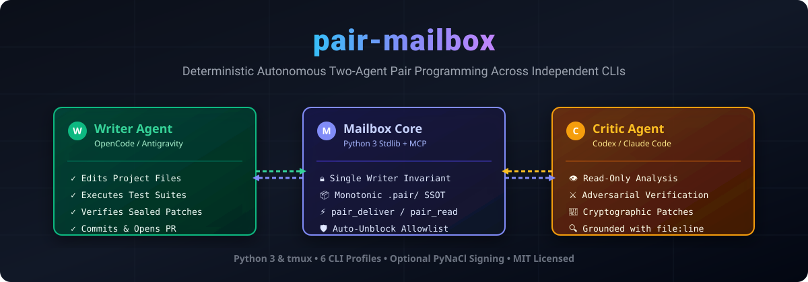

# pair-mailbox

Coordinate two coding agents in separate CLIs: one writes, the other reviews.
They share a local MCP mailbox, task list and evidence log. `pairup` starts their
tmux session and supervisor. Ordinary CLI sessions work independently.

[Русский](README.ru.md) · [Setup](docs/SETUP.md) · [Runbook](docs/RUNBOOK.md) ·
[Protocol](docs/PROTOCOL.md) · [Contributing](CONTRIBUTING.md) · [Security](SECURITY.md)



## Requirements

- Python 3.8+, Git and tmux on `PATH`.
- Two installed, authenticated CLI profiles for a pair; one for independent work.
- Bash 4.3+ for verification scripts; Bash 5 is recommended. macOS's bundled Bash
  3.2 cannot run the complete gate. See [setup](docs/SETUP.md).
- GitHub CLI (`gh`) and repository access to create or merge GitHub PRs.

The default mailbox transport uses the Python standard library. Optional Ed25519
signatures and the complete test suite require **PyNaCl**. The installer does not
install agent CLIs, authenticate them, or select their models.

## Install once

This example uses `$HOME/pair-mailbox`. Use your existing clone if you have one.
Keep the engine clone available: installed MCP entries point to it.

```bash
git clone https://github.com/AVP-Dev/pair-mailbox.git "$HOME/pair-mailbox"
cd "$HOME/pair-mailbox"
./install.sh --list
./install.sh codex agy
./bin/pairup --install
export PATH="$HOME/.local/bin:$PATH"
```

Replace `codex agy` with installed profiles, or use `./install.sh` for all detected
profiles. Persist the PATH line in `~/.zshrc` (zsh) or `~/.bashrc` (interactive bash).
The installer updates MCP, instructions, skills and native permission settings
for the selected CLIs. Replaced MCP/instruction files receive backups. Configuration
paths and verification are in [setup](docs/SETUP.md).

## Work independently

From your target project, start the CLI normally and give it the task:
Replace the example project path with your actual project directory.

```bash
cd "$HOME/work/my-project"
codex
# Or: agy
```

No pair claim or peer is needed. Outside an explicit pair, the installed MCP entry
initializes with an empty tool catalog. Old `.pair` directories and inherited
`PAIR_*` values assign no role. Restart an already open CLI after configuration
or instruction updates.

## Start a pair

From your target project:

For a project whose trunk is `main`, configure it once as shown in
[setup](docs/SETUP.md#target-projects-trunk). The engine defaults to `master`.

```bash
pairup --writer codex "Inspect the project and fix the retry bug"
```

`--writer` is optional: the launcher uses the existing writer arrangement, then
an available profile. The critic is an available different CLI. The task is stored
in `.pair`; Codex and agy also receive an initial interactive prompt.
By default the agents work in an isolated Git worktree while `.pair` stays in the
main checkout. `pairup --in-place` uses the current checkout instead. Repeating
`pairup` attaches to the existing session.

```bash
pairup                              # Start or attach
pairup --task "Review retry handling" # Alternative to a quoted task
pairup --swap agy                    # Replace critic, retain writer
pairup --worktree feature/retry      # Run in a separate Git worktree
```

Use one quoted task argument. `pairup codex agy` does not select two CLIs and is
not supported. Run `pairup --help` for all options.
For two copies of the same CLI, run the engine script from your target project:

```bash
PAIR_HOME="$HOME/pair-mailbox"
"$PAIR_HOME/bin/pair-duo" codex "Fix retry handling"
```

The derived roles are `codex-writer` and `codex-critic`. `PAIR_HOME` is just a
shell variable for the engine clone, not a pair-mailbox setting.

## Profiles

[cli-profiles.json](cli-profiles.json) is the source of truth.

| Profile | CLI | MCP configuration |
|---|---|---|
| `opencode` | OpenCode | `~/.config/opencode/opencode.jsonc` |
| `agy` | Antigravity CLI | `~/.gemini/config/mcp_config.json` |
| `codex` | Codex CLI | `~/.codex/config.toml` |
| `claude` | Claude Code | `~/.claude.json` |
| `pi` | Pi Coding Agent | `~/.pi/agent/mcp.json` |
| `omp` | OMP Coding Agent | `~/.omp/agent/mcp.json` |

The Codex pair profile uses `codex --no-daemon` to keep MCP under that CLI
instance. Use a CLI version supporting its configured launch flags.

## Inspect a project

Only `pairup` gets a global shim. Run other tools by their engine path while your
working directory is the target project, or pass a supported `--state` option.

```bash
PAIR_HOME="$HOME/pair-mailbox"
"$PAIR_HOME/bin/pairctl" status
"$PAIR_HOME/bin/pairctl" tasks
"$PAIR_HOME/bin/pairctl" budget
"$PAIR_HOME/bin/pairchat" --once
"$PAIR_HOME/bin/pairboard" --print-json
"$PAIR_HOME/bin/pairdoctor"
```

The [runbook](docs/RUNBOOK.md) covers authority, autonomy, tmux attachment and
recovery. `finish.sh` is a slower maintenance entry point; use `pairup` daily.

## Working principle and boundaries

- In an enrolled pair, `pair_state` and `pair_claim` are **MCP tool calls**, not
  shell commands. The writer edits; the critic reviews and proposes SHA-256-sealed
  patches. A disconnected critic retains its read-only boundary.
- Server checks apply to pair operations. This is not an OS sandbox; CLI permissions
  and agent instructions also matter. See the [threat model](docs/THREAT_MODEL.md).
- The mailbox stores messages. `pair_deliver` attempts a tmux wake-up; delivery
  does not prove that the peer read or acted on the task.
- Mailbox reading is bounded: **one read per turn**. Use the returned `ack_token`
  to acknowledge the batch on a later read. See [pair-chat](skills/pair-chat/SKILL.md).
- The supervisor nudges roles, handles permitted prompts and restarts dead agents
  according to autonomy settings. Finishing or merging still requires the
  recorded evidence and applicable review gates.
- Native subagents report to their parent. The engine coordinates two top-level
  roles. Automatic team-lead hierarchies, cross-CLI worker pools and model/budget
  routing are not implemented.

## Verification

From the engine clone, with a supported Bash on `PATH`:

```bash
cd "$HOME/pair-mailbox"
python3 -m venv .venv
. .venv/bin/activate
python -m pip install pynacl
./scripts/verify-changed.sh
./scripts/verify-project.sh --list
./scripts/verify-project.sh --jobs 1
```

[verification-profile.tsv](scripts/verification-profile.tsv) defines the current
checks; [verify-map.tsv](scripts/verify-map.tsv) selects affected suites. Do not
run two gates in one worktree at once. Full CI runs on Ubuntu 24.04 with Python
3.8–3.12. Some process/tmux tests require Linux; the complete gate is not currently
portable to macOS even though CLI launch works there.

## Documentation

- [Setup](docs/SETUP.md): dependencies, installation and configuration.
- [Runbook](docs/RUNBOOK.md): daily commands and troubleshooting.
- [How it works](docs/HOW-IT-WORKS.md) and [protocol](docs/PROTOCOL.md).
- [Project structure](docs/project-structure.md) and [skills](skills/README.md).
- [Open backlog](docs/backlog/README.md): confirmed outstanding work.
- [Round records](docs/rounds/) and [archive](docs/archive/): historical records.
- [Media](docs/MEDIA.md): assets and recording instructions.

Contributions target `master`. A PR requests merging a working branch into it;
merged temporary branches can then be removed. See [CONTRIBUTING.md](CONTRIBUTING.md).

[Aliaksei Patskevich (AVPDev)](https://avpdev.com/) · [MIT license](LICENSE)
