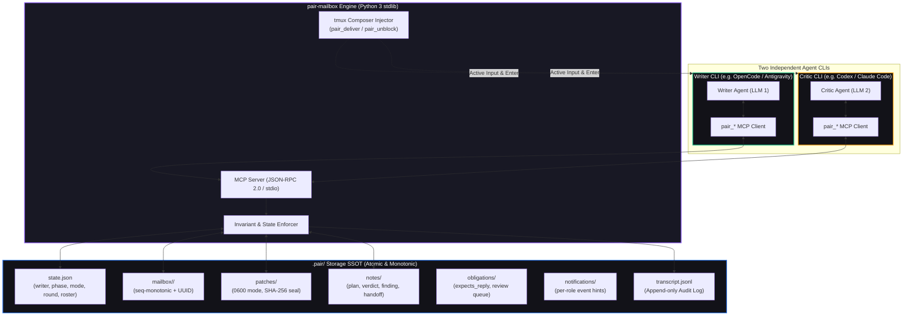

<div align="center">

<h1 align="center">pair-mailbox</h1>

<p align="center">
  <strong>Deterministic, Autonomous Two-Agent Pair Programming Across Independent CLIs</strong>
</p>

<p align="center">
  <a href="https://github.com/AVP-Dev/pair-mailbox"></a>
  <a href="https://modelcontextprotocol.io/"></a>
  
  
  <a href="https://github.com/AVP-Dev/pair-mailbox/blob/master/LICENSE"></a>
</p>

<p align="center">
  <strong>English</strong> &bull; <a href="./README.ru.md">🇷🇺 Читать на русском</a> &bull; <a href="./docs/PROTOCOL.md">📜 Protocol</a> [<a href="./docs/PROTOCOL.ru.md">ru</a>] &bull; <a href="./docs/HOW-IT-WORKS.md">💡 How It Works</a> [<a href="./docs/HOW-IT-WORKS.ru.md">ru</a>] &bull; <a href="./docs/RUNBOOK.md">🛠 Runbook</a> [<a href="./docs/RUNBOOK.ru.md">ru</a>]
</p>

<p align="center">
  <em>Turn any two autonomous AI coding agents (OpenCode, Claude Code, Antigravity, OpenAI Codex) into a disciplined, self-orchestrating pair: one writes code while the other adversarial-reviews, tests, and proposes cryptographically sealed patches — with zero manual message relaying between them. Give the task and accept the PR: by default the pair works the round to a finished PR under <code>auto</code>, with no word asked of you in between. <code>semi</code> is there when you want one word at the verify checkpoint. Secrets, deploys, migrations and irreversible deletions stop the pair in every mode.</em>
</p>

</div>

---

## ⚡ Why pair-mailbox?

An AI agent working alone is susceptible to its own assumptions: it gladly accepts its own reasoning, skips adversarial verification, and writes tests that validate its own misunderstandings. 

**pair-mailbox** solves this by pairing **two independent CLI agents** (running different models, different prompts, and completely isolated context windows) on the same codebase under strict, server-enforced engineering invariants:

1. **Strict Single Writer Protocol Invariant**: Exactly one agent holds write authority (`pair_claim`). The MCP server strictly enforces the protocol boundaries: it refuses patch reservations from the writer (who edits directly), forbids the critic from verifying patches or advancing phases, and logs all refused attempts to the audit transcript. Agents' instructions and dynamic runtime guards (`pair-guard`) ensure the reviewer remains read-only and submits changes exclusively via sealed patches.
2. **Cryptographically Sealed Patches**: The reviewer proposes changes through isolated patch files (`0600`), sealed with SHA-256 hashes that the writer verifies immediately before applying.
3. **The Mailbox Is the Guarantee, Delivery Is the Accelerator**: **A turn ends with a bounded `pair_read`** — `pair_read(wait_seconds=N)`. Nothing in any MCP implementation can inject a turn into another agent's client: MCP is client-driven, the server answers requests and cannot push the host. So the only universal wake-up is the agent reading its own mailbox, and an agent that ends its turn this way is never idle with unread mail — it is either reading or it already has the message. The body always lands in the mailbox; `pair_deliver` types only a short pointer into the peer's pane and presses Enter, which is faster where the composer is visible, but a full-screen TUI hides it, so delivery is best-effort and the mailbox always works. The human user never acts as an RFC 1149 messenger copying text between windows.
4. **Autonomous CLI Permission Unblocking (`pair_unblock`)**: Interactive prompts like `[y/N]` or `Allow command execution?` inside tmux are automatically detected and approved by the peer or background watchdog (`pairwatch --unblock`), eliminating unattended stalls.
5. **Atomic, Crash-Resilient State & File Locking**: Monotonic numbering (`000001-<UTC-stamp>-<role>-<token>.json`, numeric prefix sorts chronologically), atomic file writes (`replace`), and advisory `fcntl.flock` locks preventing race conditions between concurrent CLI processes. Full append-only audit trail logging every message, claim, phase change, and rejection.
6. **Zero Dependencies**: Pure Python 3 standard library. Runs on Linux and POSIX systems with `tmux` and `python3` (10+) with zero pip packages to install.

---

## 🏛️ System Architecture



---

## 🚀 Quickstart

### 1. Installation

Clone and install into your local environment:

```bash
git clone https://github.com/AVP-Dev/pair-mailbox.git
cd pair-mailbox
./install.sh
```

`install.sh` automatically detects all supported CLIs present on your machine, configures their MCP settings, installs skills and prompts, and validates the connection with a live handshake test.

```bash
./install.sh --list     # Inspect detected CLIs
./install.sh --check    # Run non-destructive verification
./install.sh codex      # Install to a specific CLI only
```

### 2. Supported CLI Profiles

| Profile | Application | MCP Config Location | Agent Definition |
|---|---|---|---|
| `opencode` | OpenCode | `~/.config/opencode/opencode.jsonc` | `~/.config/opencode/AGENTS.md` |
| `agy` | Antigravity CLI | `~/.gemini/config/mcp_config.json` | `~/.gemini/AGENTS.md` |
| `codex` | OpenAI Codex CLI | `~/.codex/config.toml` | `~/.codex/AGENTS.md` |
| `claude` | Claude Code | `~/.claude.json` | `~/.claude/CLAUDE.md` |
| `pi` | Pi Coding Agent | `~/.pi/agent/mcp.json` | `~/.pi/agent/AGENTS.md` |
| `omp` | OMP Coding Agent | `~/.omp/agent/mcp.json` | `~/.omp/agent/AGENTS.md` |

*`pairup --swap` supports all six profiles (`opencode`, `agy`, `codex`, `claude`, `pi`, `omp`). To add any custom CLI: append an entry to `cli-profiles.json` and run `./install.sh <name>`.*

### 3. Launching a Pair Session

From your project directory — one command, seconds:

```bash
pairup --install   # once: puts a shim into ~/.local/bin
cd ~/work/<project> && pairup --task "fix 502 retry handling and backoff jitter"
```

`pairup` finds `.pair` by walking up from cwd, starts the supervisor if it is
dead, and raises the writer + critic from the standing arrangement. Only the
writer is pinned (`bin/pairctl roles --writer opencode --global`); the critic
is any second live role, so a CLI whose limits ran out is swapped with
`pairup --swap <cli>` and no paperwork — writer and authority untouched.

Manual form (the same thing `pairup` does for you), in two tmux panes:

**Pane 1 (e.g. OpenCode / Writer):**
```bash
opencode --standalone --auto
```

**Pane 2 (e.g. Codex / Critic):**
```bash
codex
```

In either window, simply state the goal:

```
work with the peer on: fix 502 retry handling and backoff jitter
```

The agents will read the codebase, claim roles (`pair_claim`), enter the autonomous pairing loop (Plan &rarr; Implement &rarr; Sealed Review &rarr; Test &rarr; PR), and finish the task without interrupting you.

### 4. One-command setup (`finish.sh`)

The heavy first-time path: full pipeline in 7 steps — (1) tests before install, (2) install, (3) standing roles, (4) autonomy, (5) supervisor before agents, (6) agents in fresh tmux windows, (7) status report. Takes 5–10 minutes (full test suites); for the daily start use `pairup` above.

```bash
./finish.sh --task "fix 502 retry handling and backoff jitter"
./finish.sh --no-pair        # install and verify, do not launch agents
```

No positional task argument: the task goes only through `--task`. See the header of `finish.sh` for the step order and rationale.

---

## 🛠️ CLI Operations & Monitoring

Keep full visibility into your multi-agent workflow:

```bash
pairup                       # Fast start from the project folder: supervisor-if-dead + pair (daily)
pairup --swap agy            # Critic's limits ran out: new critic pane, writer untouched
bin/pairchat               # Live streaming conversation with colored rejections (Ctrl+C to exit)
bin/pairchat --once        # Print current project chat snapshot and exit
bin/pairchat --all --once  # Cross-project telemetry: stream chats from all active workspaces
bin/pairctl all            # Table of all paired projects, current writers, and silence timers
bin/pairctl status         # Inspect current workspace state JSON
bin/pairctl why            # View active writers and their declared technical rationale
bin/pairpilot             # Supervisor: keeps the pair alive unattended (see below)
bin/pairpilot --once      # One supervisor pass, to see what it would do right now
bin/pairpilot --launch agy=agy   # How to restart a role whose process died
bin/pairwatch --unblock    # Background daemon to detect stalls and auto-approve [y/n] prompts
bin/pairdoctor             # Health check and environment diagnostic utility
pairup --swap agy            # Replace the critic pane with another CLI, writer untouched
bin/pair-duo --swap-critic agy --state <dir> --project <dir>  # Same, directly
```

### 🧭 How far the pair runs without you

`bin/pairctl autonomy <level>` (default `auto`). This axis is separate from the round
mode above, because one asks *what the round is for* and the other *how far it goes alone*:

| Autonomy | Restarts a dead agent | Confirms permission prompts | Closing a round |
|---|---|---|---|
| **`auto`** *(Default)* | yes | only from the permission allowlist | needs recorded evidence; no word needed — the round closes itself |
| **`semi`** | yes | only from the permission allowlist | needs recorded evidence **and** one word: `bin/pairctl ok` |
| **`observe`** | no | no | human is driving; proof is still required |

Evidence is required in **every** level. An earlier version let `observe` close a round
with nothing recorded, which made the most cautious setting the only one where a round
could end on nothing at all — a side effect dressed up as a decision. `observe` means
"do less", not "do not count".

#### Picked once, at launch

The level is chosen when the pair starts and not renegotiated mid-round, so you are
asked **at most once** — and in `auto`, not at all.

```bash
pairup --task "autonomy: semi fix the thing"   # or pairctl autonomy semi
```

With no flag, the launcher resolves in this order, strongest first:

| Source | What it looks like |
|---|---|
| `task` | `autonomy: semi` on the **first line** of the task |
| `file` | `.pair/autonomy`, one word |
| `default` | `auto` |

A malformed flag is a usage error (`exit 2`), not a fall-through — a level the
human did not choose must never start silently. A malformed task line or file
falls through to the next source: refusing to start is worse than starting at a
level the human can see in `pairctl status`.

Secrets, ports, deploys, migrations, data deletion and git history stop the pair at
any level, `auto` included ([PROTOCOL.md §12](./docs/PROTOCOL.md)).

`bin/pairpilot` is the process that watches the pair while both agents are idle. It delivers
deferred messages, nudges a silent agent, confirms blocked permission prompts **from an
allowlist only** (`DEFAULT_ALLOW_PATTERNS` in `mcp/pair_mailbox/composer.py`: reads, in-project edits, tests/linters, local git, `git push` to a feature branch, `gh pr` — with `NEVER_ALLOW_PATTERNS` refused at any setting), restarts an agent whose process died while its
window lives, reports sealed patches nobody applied, writes a checkpoint digest for the
human in `semi`, and writes a report when the round closes.

It cannot move phases, grant or revoke write authority, commit, apply a peer's patch, or
touch project files. Those are the boundaries that make the arrangement safe
([PROTOCOL.md §13](./docs/PROTOCOL.md)).

### 🔒 What the supervisor may press "y" on

Only prompts matching the allowlist. The default list is `DEFAULT_ALLOW_PATTERNS` (`mcp/pair_mailbox/composer.py:909-975`): reads, in-project edits, tests and linters, local
git, `git push` to a **feature branch**, and `gh pr` (create / issue / run / workflow). That is deliberate: a read-only
default would stall the pair on every step, which is the exact failure this was built to
remove.

Refused at any allowlist setting:

- everything in PROTOCOL.md §12 — secrets, ports/deploy, DB migrations, deleting data, production;
- destroying the machine: `rm -rf /`, `rm -rf ~`, `rm -rf .`, `mkfs`, `dd if=`, `killall`;
- git history and the default branch: push to `main`/`master`, `--force`, `reset --hard`, `clean -f`;
- network and package installs: `curl`, `wget`, `pip install`, `npm install` — not because
  networking is unsafe by itself, but because it is how a protected file leaves the machine;
- piping into a shell: `| sh`, `| bash`, `$(`, `find … -exec`, which turn any read into execution.

Refusals are reported, not silent: `pilot_unblock_refused` goes to the transcript with the
reason, and the pane stays blocked for the human.

Widen or narrow it yourself:

```bash
echo '{"allow": ["Read", "grep", "git status"]}' > .pair/permissions.json
```

The decision is made on the prompt text, not by parsing the command, so a harmless word can
sit next to a dangerous one. Every approval is written to the transcript together with the
exact line that was allowed — so the journal says what got a "yes".

---

## 🔄 Dual Execution Modes

Switch modes at runtime with a single command (`bin/pairctl mode <mode>`):

| Mode | What Happens | Code Changes | Patch Flow | Purpose |
|---|---|---|---|---|
| **`fix`** *(Default)* | Writer edits, critic proposes sealed diffs, tests run, git PR opened | Yes | Active (`reserve` &rarr; `seal` &rarr; `verify`) | Ship bugfixes, features, and refactoring end-to-end. |
| **`audit`** | Both agents systematically hunt defects and try to refute each other's claims | **Zero** | Refused by server | Rigorous vulnerability / race condition audits. Verified findings land in `docs/backlog/`. |

---

## 🧰 MCP Tool Reference

`pair-mailbox` exposes 22 specialized MCP tools:

| Category | Tool | Authorized Roles | Description |
|---|---|---|---|
| **Identity & State** | `pair_state` | Both | Returns current role, write authority status, task, phase, mode, and peer status. |
| | `pair_claim` | Both | Claims write authority with a required technical rationale. Rebuffs second claims. |
| | `pair_release` | Writer | Voluntarily releases write authority with a recorded reason. |
| | `pair_advance` | Writer / Both | Advances phases forward (`writer`); rolls phases back (`both` — critic's veto power). |
| | `pair_ping` | Both | Cheap liveness heartbeat: moves `last_seen` and answers with three fields instead of the full state. |
| | `pair_digest` | Both | Token-budgeted orientation digest (task, phase, open tasks, obligations, last commit/verdict) instead of reading full history. |
| **Communication** | `pair_deliver` | Both | **Active delivery**: body goes to the peer's mailbox, only a short pointer is typed into its tmux composer (best-effort; mailbox always works). |
| | `pair_send` | Both | **Passive delivery**: Sends a message to the peer's atomic mailbox. |
| | `pair_read` | Both | Reads unread messages with optional blocking wait (`wait_seconds=45`). |
| | `pair_note` | Both | Leaves persistent notes (`plan`, `decision`, `finding`, `verdict`, `handoff`). |
| | `pair_note_index` | Both | Lists every note with its size and entry count, largest first, so an agent can decide what to read without spending tokens on content. |
| | `pair_note_read` | Both | Reads the TAIL of a note, cut at an entry boundary and capped at 400 lines. Full-note reads are how a 19k-token verdict used to be paid for on every round. |
| | `pair_task` | Both | Adds to the shared task list, marks done, or drops with a required reason. The list is append-only: only the writer closes a task, and an open task blocks the round. |
| **Safety & Patches** | `pair_patch_reserve` | Critic Only | Prepares a dedicated, mode `0600` patch file. Refused for writers and audit mode. |
| | `pair_patch_seal` | Critic Only | Computes and securely records SHA-256 digest of the unified diff. |
| | `pair_patch_verify` | Writer Only | Re-computes and verifies SHA-256 before applying. Halts immediately on mismatch. |
| | `pair_propose` | Critic Only | One call instead of six steps: the server builds the unified diff itself (`git diff HEAD` over the worktree files). Refused for writers and audit mode. |
| | `pair_patch_applied` | Writer Only | Records whether the apply succeeded. An unapplied sealed patch blocks closing the round. |
| | `pair_patch_release` | Both | Deletes a patch file by exact absolute path (globs strictly prohibited). |
| | `pair_evidence` | Both | Records a machine-checkable fact for this round (tests, lint, typecheck, commit, PR). `semi`/`auto` refuse to close a round without it. |
| **Autonomy & Audit** | `pair_unblock` | Both | Inspects peer tmux pane for CLI prompts (`[y/N]`, `Allow execution?`). Confirms only allowlisted prompts and reports refusals. |
| | `pair_transcript` | Both | Inspects full append-only audit trail including every rejected operation. |

---

## 🧠 Autonomous Skills Suite

Specialized agent skills included out of the box:

- **[`pair-work`](./skills/pair-work/SKILL.md)**: Full autonomous collaboration. Drives the 4-turn loop without asking the human for permission or relaying text.
- **[`pair-chat`](./.agents/skills/pair-chat/SKILL.md)** (mirrored at `.opencode/skills/pair-chat/SKILL.md`): Technical communication protocols, active delivery (`pair_deliver`), and strictly forbidding the "human pigeon" anti-pattern.
- **[`pair-audit`](./skills/pair-audit/SKILL.md)**: Proves test evidence is authentic: tests fail before changes, pass after, and nothing was mocked or weakened to force a green status.
- **[`root-cause`](./skills/root-cause/SKILL.md)**: 5-Whys systematic failure analysis before modifying code.
- **[`pair-backlog`](./skills/pair-backlog/SKILL.md)**: Formal lifecycle for capturing verified out-of-scope defects in `docs/backlog/`.
- **[`session-finalizer`](./skills/session-finalizer/SKILL.md)**: Finalizes a coding session via `/finish` — check → plan → confirm → cleanup → final-verify → close with verified cleanup and a final report. Not `./finish.sh` (the shell launcher for the pair session, a different tool).

---

## 🛡️ Security, Trust Boundaries & Limitations

To maintain absolute technical honesty, the pair-mailbox architecture explicitly defines what is enforced by code versus what is governed by agent protocol:

| Domain | What the Engine Enforces | What Depends on Agent Discipline / Protocol |
|---|---|---|
| **Write Authority** | Server strictly refuses `pair_patch_reserve` from the writer, refuses `pair_patch_verify` and `pair_advance` from the critic, and refuses duplicate claims. | The MCP server cannot intercept the host CLI's internal file-writing tools. Non-writers remain read-only via system prompt instructions and dynamic prompt injection (`pair-guard`). |
| **Patch Integrity** | Patches are stored with mode `0600`. SHA-256 digests are computed at sealing and re-verified at application; any mismatch causes immediate abort. | The writer agent must call `pair_patch_verify` immediately before applying and must not modify the diff manually. |
| **Terminal Delivery** | `pair_deliver` checks if the target composer is idle, types in chunks, verifies echo tail, and backspaces cleanly on error. | Requires both agents to run inside `tmux` panes with `TMUX_PANE` inherited in the MCP server environment (recorded in the `roles` roster in `.pair/state.json`). If `TMUX_PANE` is absent, delivery degrades to the passive mailbox (`pair_send` / `pair_read`). |
| **Audit Log** | Append-only transcript (`.pair/transcript.jsonl`) logs every message, claim, phase transition, and refused call. | Analysis of the transcript is done post-factum or via `bin/pairctl log`. |

---

## 🧪 Testing & Verification

The verification gate is defined by `scripts/verification-profile.tsv` (run via `./scripts/verify-project.sh`). Layers:

| Layer | What runs | When |
|---|---|---|
| `static` | `shell-syntax`, `file-size`, `comment-lint` | fast loop (~30s), before every edit |
| `positive` | 23 suites: `protocol`, `obligations`, `rolekeys`, `pairctl-authority`, `pairctl-panes`, `pairctl-read`, `supervisor`, `board-hosts`, `board-snapshot`, `board-render`, `board-cli`, `doctor`, `wake`, `wake-api`, `review`, `statecache`, `liveness`, `digest`, `panes`, `composer`, `roster-heal`, `file-size-gate-tests`, `eye-deadlock` | behaviour that must work |
| `integration` | `installer` (`python3 install_test.py`, ~6 min) | before finalization |
| `security` | `secret-baseline` (`./scripts/security-scan.sh`) | baseline with zero external dependencies |

```bash
./scripts/verify-project.sh --list     # show the gate
./scripts/verify-project.sh --dry-run  # show without running
```

Highlights covered by the test suite:
- Strict single writer enforcement and refusal of illegitimate claim attempts.
- Cryptographic patch tampering detection (`HASH MISMATCH` triggers immediate abort).
- Path traversal and glob expansion rejection.
- Advisory file locking (`fcntl.flock`) preventing race conditions between concurrent CLI processes.
- Strict monotonic message numbering (`000001-<UTC-stamp>-<role>-<token>.json`).
- CLI prompt detection, allowlist enforcement, and refusal instead of a blind `y`.
- The closing gate: no evidence, failing evidence, an unapplied sealed patch, or a missing
  human `ok` in `semi` each block `done` with a message naming the fix.
- Supervisor restart safety: a live process is never respawned, an unknown launch command
  is never guessed, `observe` never restarts, and write authority is never touched.
- Autonomy resolution: a fresh state and a reset both land on `auto`, a flag beats a task
  line, a task line beats a file, a file beats the default, and the source is recorded.
- The unread nudge is sent once per unread batch and appears in the transcript — reading
  resets it, so the next letter wakes again; a hanging request repeats every 2h until answered.
- Permission context is not permission consent: a frame containing "allow" is not a grant.

---

## 🤝 Support & Contribution

If you find a bug, have architectural suggestions, or want to contribute new CLI integrations:

- [Open a GitHub Issue](https://github.com/AVP-Dev/pair-mailbox/issues)
- [Submit a Pull Request](https://github.com/AVP-Dev/pair-mailbox/pulls)
- Follow the rules in [`docs/PROTOCOL.md`](docs/PROTOCOL.md) and [`AGENTS.md`](AGENTS.md).

---

<div align="center">

<p align="center">
  <a href="https://avpdev.com/"><strong>Aliaksei Patskevich (AVPDev)</strong></a><br />
  <small>AI SOLUTIONS ARCHITECT &bull; <a href="https://linkedin.com/in/avp-dev">LINKEDIN</a> &bull; <a href="https://t.me/AVP_Dev">TELEGRAM</a> &bull; <a href="https://github.com/AVP-Dev">GITHUB</a></small>
</p>

<p align="center">
  
  
  
  
</p>

</div>
