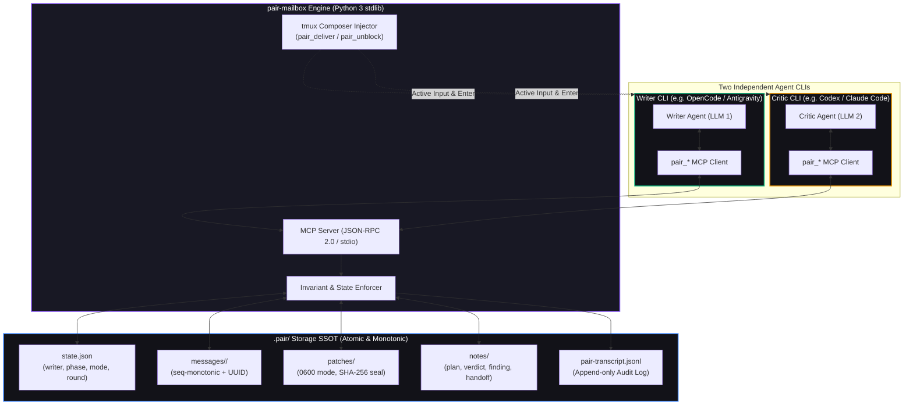

<div align="center">

<h1 align="center">pair-mailbox</h1>

<p align="center">
  <strong>Deterministic, Autonomous Two-Agent Pair Programming Across Independent CLIs</strong>
</p>

<p align="center">
  <a href="https://github.com/AVP-Dev/pair-mailbox"></a>
  <a href="https://modelcontextprotocol.io/"></a>
  
  
  <a href="https://github.com/AVP-Dev/pair-mailbox/blob/master/LICENSE"></a>
</p>

<p align="center">
  <strong>English</strong> &bull; <a href="./README.ru.md">🇷🇺 Читать на русском</a> &bull; <a href="./docs/PROTOCOL.md">📜 Protocol</a> &bull; <a href="./docs/HOW-IT-WORKS.md">💡 How It Works</a> &bull; <a href="./docs/RUNBOOK.md">🛠 Runbook</a>
</p>

<p align="center">
  <em>Turn any two autonomous AI coding agents (OpenCode, Claude Code, Antigravity, OpenAI Codex) into a disciplined, self-orchestrating pair: one writes code while the other adversarial-reviews, tests, and proposes cryptographically sealed patches — fully autonomously, with zero manual message relaying.</em>
</p>

</div>

---

## ⚡ Why pair-mailbox?

An AI agent working alone is susceptible to its own assumptions: it gladly accepts its own reasoning, skips adversarial verification, and writes tests that validate its own misunderstandings. 

**pair-mailbox** solves this by pairing **two independent CLI agents** (running different models, different prompts, and completely isolated context windows) on the same codebase under strict, server-enforced engineering invariants:

1. **Strict Single Writer Protocol Invariant**: Exactly one agent holds write authority (`pair_claim`). The MCP server strictly enforces the protocol boundaries: it refuses patch reservations from the writer (who edits directly), forbids the critic from verifying patches or advancing phases, and logs all refused attempts to the audit transcript. Agents' instructions and dynamic runtime guards (`pair-guard`) ensure the reviewer remains read-only and submits changes exclusively via sealed patches.
2. **Cryptographically Sealed Patches**: The reviewer proposes changes through isolated patch files (`0600`), sealed with SHA-256 hashes that the writer verifies immediately before applying.
3. **Active Terminal Injection (`pair_deliver`) — No "Human Pigeon"**: When agents run in `tmux` panes, they actively wake each other by typing directly into their peer's composer and pressing Enter. The human user never acts as an RFC 1149 messenger copying text between windows.
4. **Autonomous CLI Permission Unblocking (`pair_unblock`)**: Interactive prompts like `[y/N]` or `Allow command execution?` inside tmux are automatically detected and approved by the peer or background watchdog (`pairwatch --unblock`), eliminating unattended stalls.
5. **Atomic, Crash-Resilient State & File Locking**: Monotonic message sequencing (`seq-000001-...` with random tokens), atomic file writes (`replace`), and advisory `fcntl.flock` locks preventing race conditions between concurrent CLI processes. Full append-only audit trail logging every message, claim, phase change, and rejection.
6. **Zero Dependencies**: Pure Python 3 standard library. Runs on Linux and POSIX systems with `tmux` and `python3` (10+) with zero pip packages to install.

---

## 🏛️ System Architecture



---

## 🚀 Quickstart

### 1. Installation

Clone and install into your local environment:

```bash
git clone https://github.com/AVP-Dev/pair-mailbox.git
cd pair-mailbox
./install.sh
```

`install.sh` automatically detects all supported CLIs present on your machine, configures their MCP settings, installs skills and prompts, and validates the connection with a live handshake test.

```bash
./install.sh --list     # Inspect detected CLIs
./install.sh --check    # Run non-destructive verification
./install.sh codex      # Install to a specific CLI only
```

### 2. Supported CLI Profiles

| CLI Role | Application | Config Location | Agent Definition |
|---|---|---|---|
| `opencode` | OpenCode | `~/.config/opencode/opencode.json` | `.opencode/agents/writer.md` |
| `agy` | Antigravity CLI | `~/.gemini/antigravity-cli/mcp/` | `.agents/agents/pair-writer/` |
| `codex` | OpenAI Codex CLI | `~/.codex/config.json` | Auto-configured MCP |
| `claude` | Claude Code | `~/.claude/config.json` | Auto-configured MCP |

*To add any custom CLI: append an entry to `cli-profiles.json` and run `./install.sh <name>`.*

### 3. Launching a Pair Session

Open two tmux panes in your project directory:

**Pane 1 (e.g. OpenCode / Writer):**
```bash
# Start your CLI
opencode
```

**Pane 2 (e.g. Codex / Critic):**
```bash
# Start second CLI
codex
```

In either window, simply state the goal:

```
work with the peer on: fix 502 retry handling and backoff jitter
```

The agents will read the codebase, claim roles (`pair_claim`), enter the autonomous pairing loop (Plan &rarr; Implement &rarr; Sealed Review &rarr; Test &rarr; PR), and finish the task without interrupting you.

---

## 🛠️ CLI Operations & Monitoring

Keep full visibility into your multi-agent workflow:

```bash
bin/pairchat               # Live streaming conversation with colored rejections (Ctrl+C to exit)
bin/pairchat --once        # Print current project chat snapshot and exit
bin/pairchat --all --once  # Cross-project telemetry: stream chats from all active workspaces
bin/pairctl all            # Table of all paired projects, current writers, and silence timers
bin/pairctl status         # Inspect current workspace state JSON
bin/pairctl why            # View active writers and their declared technical rationale
bin/pairwatch --unblock    # Background daemon to detect stalls and auto-approve [y/n] prompts
bin/pairdoctor             # Health check and environment diagnostic utility
bin/pair-duo opencode "task"   # Launch same-CLI dual session (writer/critic split in tmux)
bin/pair-duo --worktree claude # Launch with isolated git worktree for the critic
```

---

## 🔄 Dual Execution Modes

Switch modes at runtime with a single command (`bin/pairctl mode <mode>`):

| Mode | What Happens | Code Changes | Patch Flow | Purpose |
|---|---|---|---|---|
| **`fix`** *(Default)* | Writer edits, critic proposes sealed diffs, tests run, git PR opened | Yes | Active (`reserve` &rarr; `seal` &rarr; `verify`) | Ship bugfixes, features, and refactoring end-to-end. |
| **`audit`** | Both agents systematically hunt defects and try to refute each other's claims | **Zero** | Refused by server | Rigorous vulnerability / race condition audits. Verified findings land in `docs/backlog/`. |

---

## 🧰 MCP Tool Reference

`pair-mailbox` exposes 14 specialized MCP tools:

| Category | Tool | Authorized Roles | Description |
|---|---|---|---|
| **Identity & State** | `pair_state` | Both | Returns current role, write authority status, task, phase, mode, and peer status. |
| | `pair_claim` | Both | Claims write authority with a required technical rationale. Rebuffs second claims. |
| | `pair_release` | Writer | Voluntarily releases write authority with a recorded reason. |
| | `pair_advance` | Writer / Both | Advances phases forward (`writer`); rolls phases back (`both` — critic's veto power). |
| **Communication** | `pair_deliver` | Both | **Active delivery**: Types directly into peer's tmux composer and presses Enter. |
| | `pair_send` | Both | **Passive delivery**: Sends a message to the peer's atomic mailbox. |
| | `pair_read` | Both | Reads unread messages with optional blocking wait (`wait_seconds=45`). |
| | `pair_note` | Both | Leaves persistent notes (`plan`, `decision`, `finding`, `verdict`, `handoff`). |
| **Safety & Patches** | `pair_patch_reserve` | Critic Only | Prepares a dedicated, mode `0600` patch file. Refused for writers and audit mode. |
| | `pair_patch_seal` | Critic Only | Computes and securely records SHA-256 digest of the unified diff. |
| | `pair_patch_verify` | Writer Only | Re-computes and verifies SHA-256 before applying. Halts immediately on mismatch. |
| | `pair_patch_release` | Both | Deletes a patch file by exact absolute path (globs strictly prohibited). |
| **Autonomy & Audit** | `pair_unblock` | Both | Inspects peer tmux pane for CLI prompts (`[y/N]`, `Allow execution?`) and resolves them. |
| | `pair_transcript` | Both | Inspects full append-only audit trail including every rejected operation. |

---

## 🧠 Autonomous Skills Suite

Specialized agent skills included out of the box:

- **[`pair-work`](file:///home/alexios/work/umputum/skills/pair-work/SKILL.md)**: Full autonomous collaboration. Drives the 4-turn loop without asking the human for permission or relaying text.
- **[`pair-chat`](file:///home/alexios/work/umputum/.agents/skills/pair-chat/SKILL.md)**: Technical communication protocols, active delivery (`pair_deliver`), and strictly forbidding the "human pigeon" anti-pattern.
- **[`pair-audit`](file:///home/alexios/.gemini/config/skills/pair-audit/SKILL.md)**: Proves test evidence is authentic: tests fail before changes, pass after, and nothing was mocked or weakened to force a green status.
- **[`root-cause`](file:///home/alexios/.gemini/config/skills/root-cause/SKILL.md)**: 5-Whys systematic failure analysis before modifying code.
- **[`pair-backlog`](file:///home/alexios/.gemini/config/skills/pair-backlog/SKILL.md)**: Formal lifecycle for capturing verified out-of-scope defects in `docs/backlog/`.

---

## 🛡️ Security, Trust Boundaries & Limitations

To maintain absolute technical honesty, the pair-mailbox architecture explicitly defines what is enforced by code versus what is governed by agent protocol:

| Domain | What the Engine Enforces | What Depends on Agent Discipline / Protocol |
|---|---|---|
| **Write Authority** | Server strictly refuses `pair_patch_reserve` from the writer, refuses `pair_patch_verify` and `pair_advance` from the critic, and refuses duplicate claims. | The MCP server cannot intercept the host CLI's internal file-writing tools. Non-writers remain read-only via system prompt instructions and dynamic prompt injection (`pair-guard`). |
| **Patch Integrity** | Patches are stored with mode `0600`. SHA-256 digests are computed at sealing and re-verified at application; any mismatch causes immediate abort. | The writer agent must call `pair_patch_verify` immediately before applying and must not modify the diff manually. |
| **Terminal Delivery** | `pair_deliver` checks if the target composer is idle, types in chunks, verifies echo tail, and backspaces cleanly on error. | Requires both agents to run inside `tmux` panes with `TMUX_PANE` inherited in the MCP server environment (recorded in `.pair/state.json`). If `TMUX_PANE` is absent, delivery degrades to the passive mailbox (`pair_send` / `pair_read`). |
| **Audit Log** | Append-only transcript (`pair-transcript.jsonl`) logs every message, claim, phase transition, and refused call. | Analysis of the transcript is done post-factum or via `bin/pairctl log`. |

---

## 🧪 Testing & Verification

The test suite validates security boundaries, race conditions, and invariant enforcement:

```bash
python3 mcp/pair_mailbox/test_protocol.py
```

Highlights covered by the test suite (92/92 tests green):
- Strict single writer enforcement and refusal of illegitimate claim attempts.
- Cryptographic patch tampering detection (`HASH MISMATCH` triggers immediate abort).
- Path traversal and glob expansion rejection.
- Advisory file locking (`fcntl.flock`) preventing race conditions between concurrent CLI processes.
- Strict monotonic message sequencing (`seq-000001-...` with tokenized filenames).
- CLI prompt detection and non-intrusive auto-unblocking.

---

## 🤝 Support & Contribution

If you find a bug, have architectural suggestions, or want to contribute new CLI integrations:

- [Open a GitHub Issue](https://github.com/AVP-Dev/pair-mailbox/issues)
- [Submit a Pull Request](https://github.com/AVP-Dev/pair-mailbox/pulls)
- Follow the rules in [`docs/PROTOCOL.md`](docs/PROTOCOL.md) and [`AGENTS.md`](AGENTS.md).

---

<div align="center">

<p align="center">
  <a href="https://avpdev.com/"><strong>Aliaksei Patskevich (AVPDev)</strong></a><br />
  <small>AI SOLUTIONS ARCHITECT &bull; <a href="https://linkedin.com/in/avp-dev">LINKEDIN</a> &bull; <a href="https://t.me/AVP_Dev">TELEGRAM</a> &bull; <a href="https://github.com/AVP-Dev">GITHUB</a></small>
</p>

<p align="center">
  
  
  
  
</p>

</div>
