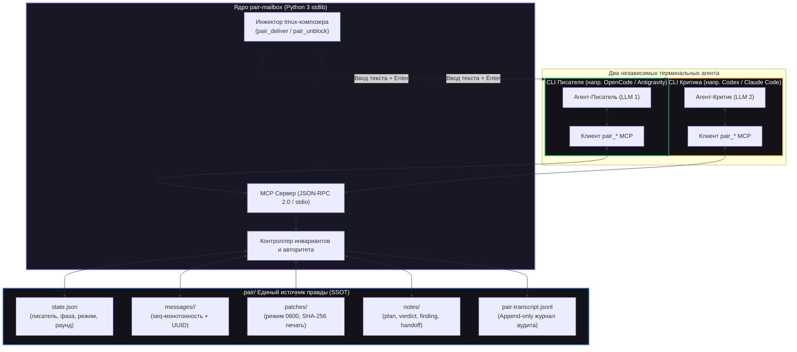

<div align="center">

<h1 align="center">pair-mailbox</h1>

<p align="center">
  <strong>Детерминированное автономное парное программирование двух AI-агентов в независимых CLI</strong>
</p>

<p align="center">
  <a href="https://github.com/AVP-Dev/pair-mailbox"></a>
  <a href="https://modelcontextprotocol.io/"></a>
  
  
  <a href="https://github.com/AVP-Dev/pair-mailbox/blob/master/LICENSE"></a>
</p>

<p align="center">
  <a href="./README.md">🇬🇧 English Version</a> &bull; <strong>Русская версия</strong> &bull; <a href="./docs/PROTOCOL.md">📜 Протокол</a> &bull; <a href="./docs/HOW-IT-WORKS.md">💡 Как это работает</a> &bull; <a href="./docs/RUNBOOK.md">🛠 Runbook</a>
</p>

<p align="center">
  <em>Объедините любых двух автономных AI-кодеров (OpenCode, Claude Code, Antigravity, OpenAI Codex) в дисциплинированную пару: один пишет код, а второй критикует, верифицирует гипотезы и предлагает криптографически опечатанные патчи — полностью автономно, без превращения человека в «почтового голубя».</em>
</p>

</div>

---

## ⚡ Зачем нужен pair-mailbox?

Один AI-агент, работая в одиночку, склонен соглашаться со своими собственными гипотезами и галлюцинациями. У него нет стимула искать скрытые дефекты в коде, который он сам только что написал.

**pair-mailbox** объединяет **двух независимых AI-агентов** (разные модели, разные промпты и раздельные контекстные окна) на одном репозитории под контролем строгих серверных инвариантов:

1. **Строгий протокольный инвариант писателя (Single Writer Invariant)**: Ровно один агент обладает правом записи (`pair_claim`). Сервер жестко контролирует границы протокола: отказывает держателю записи в резервировании патчей (писатель правит напрямую), запрещает критику верифицировать патчи или двигать фазы вперед, и логирует любые отказы в аудит. Инструкции агентов и динамический гард (`pair-guard`) гарантируют, что критик не трогает проект напрямую, а передает правки исключительно опечатанными патчами.
2. **Криптографически опечатанные патчи (Sealed Patches)**: Второй агент предлагает правки через изолированные патч-файлы (права доступа `0600`), опечатанные хешем SHA-256. Писатель обязан проверить хеш перед применением.
3. **Активное пробуждение через tmux (`pair_deliver`) — запрет «голубиной почты»**: При запуске в панелях `tmux` агенты передают управление и будят друг друга прямой вбивкой текста в строку ввода терминала соседа с нажатием Enter. Человеку больше не нужно копировать сообщения между окнами.
4. **Автоматическая разблокировка CLI-разрешений (`pair_unblock`)**: Интерактивные вопросы вида `[y/N]` или `Allow execution?` внутри tmux автоматически определяются и одобряются соседом или фоновым демоном (`pairwatch --unblock`), предотвращая зависание сессий.
5. **Атомарное состояние и файловые блокировки**: Монотонные последовательности сообщений (`seq-000001-...` со случайным токеном), атомарная запись (`replace`) и блокировки `fcntl.flock`, исключающие гонки между параллельными процессами CLI. Полный append-only журнал аудита фиксирует все действия и отказы.
6. **Ноль внешних зависимостей**: Написан на стандартной библиотеке Python 3 (10+). Работает на Linux и POSIX-системах при наличии `tmux` и `python3` без необходимости ставить сторонние pip-пакеты.

---

## 🏛️ Архитектура системы



---

## 🚀 Быстрый старт

### 1. Установка

Склонируйте репозиторий и запустите установщик:

```bash
git clone https://github.com/AVP-Dev/pair-mailbox.git
cd pair-mailbox
./install.sh
```

`install.sh` автоматически определит установленные в системе CLI, пропишет MCP-сервер в их конфигурации, установит навыки и промпты, а затем проведёт валидацию соединения реальным handshake.

```bash
./install.sh --list     # Список обнаруженных CLI
./install.sh --check    # Проверка работы без внесения изменений
./install.sh codex      # Установка для конкретного CLI
```

### 2. Поддерживаемые профили CLI

| Имя роли | Программа | Расположение конфига | Файлы агента |
|---|---|---|---|
| `opencode` | OpenCode | `~/.config/opencode/opencode.json` | `.opencode/agents/writer.md` |
| `agy` | Antigravity CLI | `~/.gemini/antigravity-cli/mcp/` | `.agents/agents/pair-writer/` |
| `codex` | OpenAI Codex CLI | `~/.codex/config.json` | Автонастройка через MCP |
| `claude` | Claude Code | `~/.claude/config.json` | Автонастройка через MCP |

*Чтобы добавить новый CLI: добавьте одну запись в `cli-profiles.json` и выполните `./install.sh <имя>`.*

### 3. Запуск парной сессии

Откройте две панели tmux в каталоге вашего проекта:

**Панель 1 (напр. OpenCode / Писатель):**
```bash
opencode
```

**Панель 2 (напр. Codex / Критик):**
```bash
codex
```

В любом из окон напишите задачу:

```
работаем вместе: починить обработку 502 ошибок и jitter ретраев
```

Агенты сами прочитают задачу и код, распределят роли (`pair_claim`), войдут в цикл автономной разработки (План &rarr; Реализация &rarr; Опечатанное ревью &rarr; Тесты &rarr; PR) и завершат работу без лишних вопросов.

---

## 🛠️ Утилиты управления и мониторинга

Полный контроль над процессом парной работы:

```bash
bin/pairchat               # Живой стриминг переписки с подсветкой отказов (выход по Ctrl+C)
bin/pairchat --once        # Разовый снимок переписки текущего проекта
bin/pairchat --all --once  # Сквозной мониторинг: сообщения со всех проектов с метками папок
bin/pairctl all            # Таблица всех спаренных проектов, текущих писателей и таймеров тишины
bin/pairctl status         # JSON-снимок состояния текущего рабочего пространства
bin/pairctl why            # Кто держит авторитет записи и какое техническое обоснование он заявил
bin/pairwatch --unblock    # Фоновый сторож: ловит зависания и автоматически жмет [y/n]
bin/pairdoctor             # Диагностика окружения и проверка доступности компонентов
```

---

## 🔄 Два режима работы

Режим переключается на лету одной командой (`bin/pairctl mode <режим>`):

| Режим | Что происходит | Изменение кода | Патчи | Назначение |
|---|---|---|---|---|
| **`fix`** *(по умолчанию)* | Писатель правит код, критик предлагает опечатанные патчи, тесты, PR в git | Да | Активны (`reserve` &rarr; `seal` &rarr; `verify`) | Реализация фич, исправление дефектов и рефакторинг. |
| **`audit`** | Оба агента ищут уязвимости и пытаются опровергнуть находки друг друга | **Нет** | Отклоняются сервером | Аудит безопасности и поиск гонок. Подтвержденные находки идут в `docs/backlog/`. |

---

## 🧰 Справочник инструментов MCP

`pair-mailbox` предоставляет 14 специализированных MCP-инструментов:

| Категория | Инструмент | Доступ | Назначение |
|---|---|---|---|
| **Идентичность и состояние** | `pair_state` | Оба | Возвращает роль, статус права записи, задачу, фазу, режим и состояние соседа. |
| | `pair_claim` | Оба | Захват права записи с техническим обоснованием. Отказ при занятом праве. |
| | `pair_release` | Писатель | Добровольный отказ от права записи с фиксацией причины. |
| | `pair_advance` | Писатель / Оба | Продвижение фаз вперед (`писатель`); откат фаз назад (`оба` — право вето критика). |
| **Связь и доставка** | `pair_deliver` | Оба | **Активная доставка**: вбивает текст прямо в композер соседа в tmux и жмет Enter. |
| | `pair_send` | Оба | **Пассивная доставка**: отправляет сообщение в атомарный ящик соседа. |
| | `pair_read` | Оба | Чтение сообщений с поддержкой ожидания (`wait_seconds=45`). |
| | `pair_note` | Оба | Долговечные заметки (`plan`, `decision`, `finding`, `verdict`, `handoff`). |
| **Безопасность и патчи** | `pair_patch_reserve` | Только критик | Резервирование файла патча с правами `0600`. Отказ писателю и в режиме audit. |
| | `pair_patch_seal` | Только критик | Расчет и фиксация криптографического хеша SHA-256 для unified diff. |
| | `pair_patch_verify` | Только писатель | Пересчет и сверка хеша SHA-256 перед наложением. Остановка при несовпадении. |
| | `pair_patch_release` | Оба | Удаление файла патча по точному абсолютному пути (глобы запрещены). |
| **Автономия и аудит** | `pair_unblock` | Оба | Проверка панели tmux соседа на запросы `[y/N]` и их подтверждение. |
| | `pair_transcript` | Оба | Просмотр append-only журнала аудита, включая все отказы сервера. |

---

## 🧠 Навыки автономных агентов

В поставку входят готовые навыки, расширяющие возможности моделей:

- **[`pair-work`](file:///home/alexios/work/umputum/skills/pair-work/SKILL.md)**: Полная автономная коллаборация: План &rarr; Код &rarr; Ревью &rarr; Тесты &rarr; PR без прерываний человека.
- **[`pair-chat`](file:///home/alexios/work/umputum/.agents/skills/pair-chat/SKILL.md)**: Протокол общения, правила активной доставки `pair_deliver` и запрет «голубиной почты».
- **[`pair-audit`](file:///home/alexios/.gemini/config/skills/pair-audit/SKILL.md)**: Аудит достоверности тестов: проверка, что тесты падали до правок и проходят после, без фиктивных моков.
- **[`root-cause`](file:///home/alexios/.gemini/config/skills/root-cause/SKILL.md)**: Анализ первопричин методом «5 Почему» до начала модификации кода.
- **[`pair-backlog`](file:///home/alexios/.gemini/config/skills/pair-backlog/SKILL.md)**: Сохранение подтвержденных дефектов вне скоупа задачи в `docs/backlog/`.

---

## 🛡️ Модель доверия, безопасность и ограничения

Для соблюдения инженерной честности архитектура pair-mailbox строго разграничивает то, что гарантируется кодом сервера, и то, что обеспечивается протоколом:

| Область | Что контролирует сервер в коде | Что держится на дисциплине агентов и промптах |
|---|---|---|
| **Право записи** | Сервер отказывает писателю в `pair_patch_reserve`, отказывает критику в `pair_patch_verify` и `pair_advance`, блокирует повторный захват роли. | MCP-сервер не может перехватить встроенные файловые инструменты хостового CLI. Критик остаётся read-only благодаря системным промптам и динамическому инжекту правил (`pair-guard`). |
| **Целостность патчей** | Патчи изолируются правами `0600`. SHA-256 считается при опечатывании и перепроверяется перед применением; несовпадение вызывает немедленный стоп. | Писатель обязан вызывать `pair_patch_verify` непосредственно перед применением и не модифицировать diff вручную. |
| **Доставка в терминал** | `pair_deliver` проверяет готовность композера, вбивает чанками, верифицирует эхо и безопасно стирает текст при сбое. | Требует запуска обоих агентов внутри панелей `tmux`. Вне tmux агенты взаимодействуют пассивно через ящик (`pair_send` / `pair_read`). |
| **Журнал аудита** | Append-only транскрипт (`pair-transcript.jsonl`) фиксирует все сообщения, захваты, фазы и каждый отказ сервера. | Анализ журнала выполняется постфактум или через `bin/pairctl log`. |

---

## 🧪 Тестирование и гарантии безопасности

Тестовый набор проверяет границы безопасности, обработку гонок и соблюдение инвариантов:

```bash
python3 mcp/pair_mailbox/test_protocol.py
```

Ключевые сценарии тестового комплекта (92/92 тестов успешно пройдены):
- Обеспечение инварианта строго одного писателя и блокировка повторного захвата.
- Детекция подмены опечатанного патча (`HASH MISMATCH` вызывает немедленный аборт).
- Защита от path traversal и запрет масок/глобов.
- Файловые блокировки `fcntl.flock`, исключающие гонки между параллельными процессами.
- Строгая монотонность номеров сообщений (`seq-000001-...` с уникальными токенами).
- Детекция интерактивных промптов CLI и безопасная авторазблокировка.

---

## 🤝 Поддержка и вклад в проект

Если вы обнаружили ошибку, хотите предложить улучшение архитектуры или добавить интеграцию с новым CLI:

- [Создайте Issue в GitHub](https://github.com/AVP-Dev/pair-mailbox/issues)
- [Отправьте Pull Request](https://github.com/AVP-Dev/pair-mailbox/pulls)
- Ознакомьтесь с правилами в [`docs/PROTOCOL.md`](docs/PROTOCOL.md) и [`AGENTS.md`](AGENTS.md).

---

<div align="center">

<p align="center">
  <a href="https://avpdev.com/"><strong>Aliaksei Patskevich (AVPDev)</strong></a><br />
  <small>AI SOLUTIONS ARCHITECT &bull; <a href="https://linkedin.com/in/avp-dev">LINKEDIN</a> &bull; <a href="https://t.me/AVP_Dev">TELEGRAM</a> &bull; <a href="https://github.com/AVP-Dev">GITHUB</a></small>
</p>

<p align="center">
  
  
  
  
</p>

</div>
