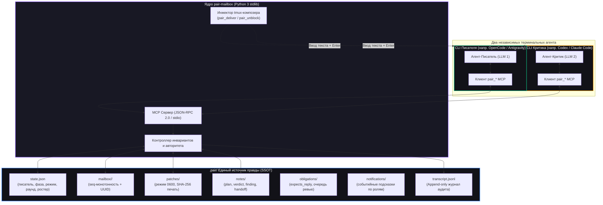

<div align="center">

<h1 align="center">pair-mailbox</h1>

<p align="center">
  <strong>Детерминированное автономное парное программирование двух AI-агентов в независимых CLI</strong>
</p>

<p align="center">
  <a href="https://github.com/AVP-Dev/pair-mailbox"></a>
  <a href="https://modelcontextprotocol.io/"></a>
  
  
  <a href="https://github.com/AVP-Dev/pair-mailbox/blob/master/LICENSE"></a>
</p>

<p align="center">
  <a href="./README.md">🇬🇧 English Version</a> &bull; <strong>Русская версия</strong> &bull; <a href="./docs/PROTOCOL.md">📜 Протокол</a> [<a href="./docs/PROTOCOL.ru.md">ru</a>] &bull; <a href="./docs/HOW-IT-WORKS.md">💡 Как это работает</a> [<a href="./docs/HOW-IT-WORKS.ru.md">ru</a>] &bull; <a href="./docs/RUNBOOK.md">🛠 Runbook</a> [<a href="./docs/RUNBOOK.ru.md">ru</a>]
</p>

<p align="center">
  <em>Объедините любых двух автономных AI-кодеров (OpenCode, Claude Code, Antigravity, OpenAI Codex) в дисциплинированную пару: один пишет код, а второй критикует, верифицирует гипотезы и предлагает криптографически опечатанные патчи — без превращения человека в «почтового голубя». Дайте задачу и примите PR: по умолчанию пара отрабатывает раунд до готового PR в режиме <code>auto</code>, и между этим вас не спрашивают ни разу. <code>semi</code> — если нужно одно слово на чекпоинте verify. Секреты, деплои, миграции и необратимые удаления останавливают пару в любом режиме.</em>
</p>

</div>

---

## ⚡ Зачем нужен pair-mailbox?

Один AI-агент, работая в одиночку, склонен соглашаться со своими собственными гипотезами и галлюцинациями. У него нет стимула искать скрытые дефекты в коде, который он сам только что написал.

**pair-mailbox** объединяет **двух независимых AI-агентов** (разные модели, разные промпты и раздельные контекстные окна) на одном репозитории под контролем строгих серверных инвариантов:

1. **Строгий протокольный инвариант писателя (Single Writer Invariant)**: Ровно один агент обладает правом записи (`pair_claim`). Сервер жестко контролирует границы протокола: отказывает держателю записи в резервировании патчей (писатель правит напрямую), запрещает критику верифицировать патчи или двигать фазы вперед, и логирует любые отказы в аудит. Инструкции агентов и динамический гард (`pair-guard`) гарантируют, что критик не трогает проект напрямую, а передает правки исключительно опечатанными патчами.
2. **Криптографически опечатанные патчи (Sealed Patches)**: Второй агент предлагает правки через изолированные патч-файлы (права доступа `0600`), опечатанные хешем SHA-256. Писатель обязан проверить хеш перед применением.
3. **Ящик — гарантия, доставка — ускоритель (запрет «голубиной почты»)**: **Ход агента заканчивается ограниченным `pair_read`** — `pair_read(wait_seconds=N)`. Ни в одной реализации MCP сервер не может вставить ход в клиента: MCP ведёт клиент, сервер отвечает на запросы и не может подтолкнуть хост. Поэтому единственное универсальное пробуждение — агент читает свой ящик сам, и агент, который так заканчивает ход, не бывает в простое с непрочитанной почтой: он либо читает, либо уже прочитал. Тело письма всегда лежит в ящике, а `pair_deliver` печатает в композер соседа лишь короткий указатель — быстрее там, где композер виден, но полноэкранный TUI его прячет, поэтому доставка best-effort, а ящик работает всегда. Человеку больше не нужно копировать сообщения между окнами.
4. **Автоматическая разблокировка CLI-разрешений (`pair_unblock`)**: Интерактивные вопросы вида `[y/N]` или `Allow execution?` внутри tmux автоматически определяются и одобряются соседом или фоновым демоном (`pairwatch --unblock`), предотвращая зависание сессий.
5. **Атомарное состояние и файловые блокировки**: Монотонная нумерация сообщений (`000001-<UTC-штамп>-<роль>-<токен>.json`, числовой префикс сортируется по времени), атомарная запись (`replace`) и блокировки `fcntl.flock`, исключающие гонки между параллельными процессами CLI. Полный append-only журнал аудита фиксирует все действия и отказы.
6. **Ноль внешних зависимостей**: Написан на стандартной библиотеке Python 3 (10+). Работает на Linux и POSIX-системах при наличии `tmux` и `python3` без необходимости ставить сторонние pip-пакеты.

---

## 🏛️ Архитектура системы



---

## 🚀 Быстрый старт

### 1. Установка

Склонируйте репозиторий и запустите установщик:

```bash
git clone https://github.com/AVP-Dev/pair-mailbox.git
cd pair-mailbox
./install.sh
```

`install.sh` автоматически определит установленные в системе CLI, пропишет MCP-сервер в их конфигурации, установит навыки и промпты, а затем проведёт валидацию соединения реальным handshake.

```bash
./install.sh --list     # Список обнаруженных CLI
./install.sh --check    # Проверка работы без внесения изменений
./install.sh codex      # Установка для конкретного CLI
```

### 2. Поддерживаемые профили CLI

| Профиль | Программа | Расположение MCP-конфига | Файлы агента |
|---|---|---|---|
| `opencode` | OpenCode | `~/.config/opencode/opencode.jsonc` | `~/.config/opencode/AGENTS.md` |
| `agy` | Antigravity CLI | `~/.gemini/config/mcp_config.json` | `~/.gemini/AGENTS.md` |
| `codex` | OpenAI Codex CLI | `~/.codex/config.toml` | `~/.codex/AGENTS.md` |
| `claude` | Claude Code | `~/.claude.json` | `~/.claude/CLAUDE.md` |
| `pi` | Pi Coding Agent | `~/.pi/agent/mcp.json` | `~/.pi/agent/AGENTS.md` |
| `omp` | OMP Coding Agent | `~/.omp/agent/mcp.json` | `~/.omp/agent/AGENTS.md` |

*`bin/pair-duo` поддерживает только первые четыре (`opencode`, `agy`, `codex`, `claude`). Чтобы добавить новый CLI: добавьте одну запись в `cli-profiles.json` и выполните `./install.sh <имя>`.*

### 3. Запуск парной сессии

Откройте две панели tmux в каталоге вашего проекта:

**Панель 1 (напр. OpenCode / Писатель):**
```bash
opencode --standalone --auto
```

**Панель 2 (напр. Codex / Критик):**
```bash
codex
```

В любом из окон напишите задачу:

```
работаем вместе: починить обработку 502 ошибок и jitter ретраев
```

Агенты сами прочитают задачу и код, распределят роли (`pair_claim`), войдут в цикл автономной разработки (План &rarr; Реализация &rarr; Опечатанное ревью &rarr; Тесты &rarr; PR) и завершат работу без лишних вопросов.

### 4. Установка одной командой (`finish.sh`)

`./finish.sh` выполняет весь конвейер за 7 шагов: (1) тесты до установки, (2) установка, (3) постоянные роли, (4) автономность, (5) сверхвизор до агентов, (6) агенты в свежих окнах tmux, (7) отчёт о состоянии:

```bash
./finish.sh --task "починить обработку 502 ошибок и jitter ретраев"
./finish.sh --no-pair        # поставить и проверить, агентов не поднимать
```

Позиционного аргумента задачи нет: задача передаётся только через `--task`. Порядок и смысл шагов — в шапке `finish.sh`.

---

## 🛠️ Утилиты управления и мониторинга

Полный контроль над процессом парной работы:

```bash
bin/pairchat               # Живой стриминг переписки с подсветкой отказов (выход по Ctrl+C)
bin/pairchat --once        # Разовый снимок переписки текущего проекта
bin/pairchat --all --once  # Сквозной мониторинг: сообщения со всех проектов с метками папок
bin/pairctl all            # Таблица всех спаренных проектов, текущих писателей и таймеров тишины
bin/pairctl status         # JSON-снимок состояния текущего рабочего пространства
bin/pairctl why            # Кто держит авторитет записи и какое техническое обоснование он заявил
bin/pairpilot             # Сверхвизор: держит пару живой без человека (ниже)
bin/pairpilot --once      # Один проход сверхвизора: посмотреть, что он сделает прямо сейчас
bin/pairpilot --launch agy=agy   # Как поднимать роль, процесс которой умер
bin/pairwatch --unblock    # Фоновый сторож: ловит зависания и автоматически жмет [y/n]
bin/pairdoctor             # Диагностика окружения и проверка доступности компонентов
bin/pair-duo opencode "задача" # Запуск дуо-режима для одного CLI (сплит writer/critic в tmux)
bin/pair-duo --worktree claude # Запуск с изолированным git worktree для критика
```

### 🧭 Насколько далеко пара идёт сама

`bin/pairctl autonomy <уровень>` (по умолчанию `auto`). Это **отдельная** ось от режима
раунда выше: режим отвечает на вопрос «что делает раунд», автономность — «насколько далеко
он идёт без человека».

| Автономность | Перезапуск упавшего | Подтверждение разрешений | Закрытие раунда |
|---|---|---|---|
| **`auto`** *(по умолчанию)* | да | только из белого списка | нужно доказательство, слово не требуется — раунд закрывается сам |
| **`semi`** | да | только из белого списка | нужно доказательство **и** одно слово человека: `bin/pairctl ok` |
| **`observe`** | нет | нет | человек за рулём; доказательство всё равно обязательно |

Доказательство требуется в **любом** уровне. Раньше `observe` позволял закрыть раунд
вообще ни с чем, из-за чего самая осторожная настройка была единственной, где раунд
мог закончиться впустую — побочный эффект, поданный как решение. `observe` значит
«делать меньше», а не «не считать».

#### Выбирается один раз, при старте

Уровень выбирается, когда пара поднимается, и не пересматривается посреди раунда, так
что вас спрашивают **не чаще одного раза** — а в `auto` не спрашивают вовсе.

```bash
bin/pair-duo --semi opencode "задача"   # или --auto, --observe
```

Без флага запускалка решает так, по убыванию силы:

| Источник | Как выглядит |
|---|---|
| `flag` | `bin/pair-duo --semi` |
| `task` | `autonomy: semi` на **первой строке** задачи |
| `file` | `.pair/autonomy`, одно слово |
| `default` | `auto` |

Мусор во флаге — ошибка запуска (`exit 2`), а не переход дальше: уровень, который
человек не выбирал, не должен стартовать молча. Мусор в строке задачи или файле
переходит к следующему источнику: отказаться стартовать хуже, чем стартовать на
уровне, который человек видит в `pairctl status`.

Секреты, порты, деплои, миграции, удаление данных и история git останавливают пару в
любом уровне, включая `auto` ([PROTOCOL.md §12](./docs/PROTOCOL.md)).

`bin/pairpilot` — процесс, который смотрит на пару, пока оба агента простаивают. Он
доставляет отложенные сообщения, подталкивает молчащего, подтверждает зависшие запросы
разрешения **только из белого списка** (`DEFAULT_ALLOW_PATTERNS` в `mcp/pair_mailbox/composer.py`: чтение, правки внутри проекта, тесты/линтеры, локальный git, `git push` в фиче-ветку, `gh pr` — при любом списке запрещён `NEVER_ALLOW_PATTERNS`), перезапускает
агента с умершим процессом при живом окне, сигналит о зависших патчах, пишет дайджест
человеку в `semi` и отчёт при закрытии раунда.

Он не умеет двигать фазы, выдавать или забирать право записи, коммитить, применять чужие
патчи и трогать файлы проекта. Именно эти границы делают схему безопасной
([PROTOCOL.md §13](./docs/PROTOCOL.md)).

### 🔒 На что сверхвизору можно жать «y»

Только на запросы из белого списка. Список по умолчанию — `DEFAULT_ALLOW_PATTERNS` (`mcp/pair_mailbox/composer.py:909-975`): чтение, правки внутри проекта, тесты и линтеры,
локальный git, `git push` в **фиче-ветку** и `gh pr` (create / issue / run / workflow). Это осознанно: список «только
чтение» ставил бы пару колом на каждом шаге — ровно та поломка, которую это и чинит.

Отклоняется при любом белом списке:

- всё содержимое §12 PROTOCOL.md: секреты, порты и деплой, миграции БД, удаление данных, прод;
- разрушение машины: `rm -rf /`, `rm -rf ~`, `rm -rf .`, `mkfs`, `dd if=`, `killall`;
- история git и основная ветка: push в `main`/`master`, `--force`, `reset --hard`, `clean -f`;
- сеть и установка пакетов: `curl`, `wget`, `pip install`, `npm install` — не потому что сеть
  опасна сама по себе, а потому что через неё защищённый файл покидает машину;
- труба в шелл: `| sh`, `| bash`, `$(`, `find … -exec` — это превращает чтение в выполнение.

Отказ не молчит: `pilot_unblock_refused` уходит в транскрипт с причиной, а панель остаётся
заблокированной для человека.

Расширяете или сужаете сами:

```bash
echo '{"allow": ["Read", "grep", "git status"]}' > .pair/permissions.json
```

Решение принимается по тексту строки, а не по разбору команды, поэтому рядом с опасным может
стоять безобидное слово. Каждое подтверждение попадает в транскрипт вместе с самой строкой —
по журналу видно, на что именно было сказано «да».

---

## 🔄 Два режима работы

Режим переключается на лету одной командой (`bin/pairctl mode <режим>`):

| Режим | Что происходит | Изменение кода | Патчи | Назначение |
|---|---|---|---|---|
| **`fix`** *(по умолчанию)* | Писатель правит код, критик предлагает опечатанные патчи, тесты, PR в git | Да | Активны (`reserve` &rarr; `seal` &rarr; `verify`) | Реализация фич, исправление дефектов и рефакторинг. |
| **`audit`** | Оба агента ищут уязвимости и пытаются опровергнуть находки друг друга | **Нет** | Отклоняются сервером | Аудит безопасности и поиск гонок. Подтвержденные находки идут в `docs/backlog/`. |


## 🧰 Справочник инструментов MCP

`pair-mailbox` предоставляет 22 специализированных MCP-инструмента:

| Категория | Инструмент | Доступ | Назначение |
|---|---|---|---|
| **Идентичность и состояние** | `pair_state` | Оба | Возвращает роль, статус права записи, задачу, фазу, режим и состояние соседа. |
| | `pair_claim` | Оба | Захват права записи с техническим обоснованием. Отказ при занятом праве. |
| | `pair_release` | Писатель | Добровольный отказ от права записи с фиксацией причины. |
| | `pair_advance` | Писатель / Оба | Продвижение фаз вперед (`писатель`); откат фаз назад (`оба` — право вето критика). |
| | `pair_ping` | Оба | Дешёвый heartbeat живости: двигает `last_seen` и отвечает тремя полями вместо полного состояния. |
| | `pair_digest` | Оба | Ориентационный дайджест в лимите токенов (задача, фаза, открытые задачи, обязательства, последний коммит/вердикт) вместо чтения всей истории. |
| **Связь и доставка** | `pair_deliver` | Оба | **Активная доставка**: текст — в ящик соседа, в его tmux-композер печатается только короткий указатель (best-effort; ящик срабатывает всегда). |
| | `pair_send` | Оба | **Пассивная доставка**: отправляет сообщение в атомарный ящик соседа. |
| | `pair_read` | Оба | Чтение сообщений с поддержкой ожидания (`wait_seconds=45`). |
| | `pair_note` | Оба | Долговечные заметки (`plan`, `decision`, `finding`, `verdict`, `handoff`). |
| | `pair_note_index` | Оба | Список всех заметок с размером и числом записей, сначала крупные: позволяет решить, что читать, не тратя токены на содержимое. |
| | `pair_note_read` | Оба | Прочитать ХВОСТ заметки с обрезкой по границе записей и потолком в 400 строк. Чтение целиком — это то, за что раньше платили 19 тысяч токенов за раунд. |
| | `pair_task` | Оба | Добавить в общий список задач, отметить выполненным или снять с обязательным указанием причины. Список дополняется, а не перезаписывается: закрывает задачу только писатель, открытая задача блокирует раунд. |
| **Безопасность и патчи** | `pair_patch_reserve` | Только критик | Резервирование файла патча с правами `0600`. Отказ писателю и в режиме audit. |
| | `pair_patch_seal` | Только критик | Расчет и фиксация криптографического хеша SHA-256 для unified diff. |
| | `pair_patch_verify` | Только писатель | Пересчет и сверка хеша SHA-256 перед наложением. Остановка при несовпадении. |
| | `pair_propose` | Только критик | Один вызов вместо шести шагов: сервер сам строит unified diff (`git diff HEAD` по файлам worktree). Отказ писателю и в режиме audit. |
| | `pair_patch_applied` | Только писатель | Фиксирует исход наложения. Неприменённый опечатанный патч держит раунд открытым. |
| | `pair_patch_release` | Оба | Удаление файла патча по точному абсолютному пути (глобы запрещены). |
| | `pair_evidence` | Оба | Записывает машинно-проверяемый факт текущего раунда (тесты, lint, typecheck, коммит, PR). В `semi`/`auto` без него раунд не закрыть. |
| **Автономия и аудит** | `pair_unblock` | Оба | Проверка панели tmux соседа на запросы `[y/N]`. Подтверждает только то, что в белом списке, и сообщает об отказе. |
| | `pair_transcript` | Оба | Просмотр append-only журнала аудита, включая все отказы сервера. |

---

## 🧠 Навыки автономных агентов

В поставку входят готовые навыки, расширяющие возможности моделей:

- **[`pair-work`](./skills/pair-work/SKILL.md)**: Полная автономная коллаборация: План &rarr; Код &rarr; Ревью &rarr; Тесты &rarr; PR без прерываний человека.
- **[`pair-chat`](./.agents/skills/pair-chat/SKILL.md)** (дубль в `.opencode/skills/pair-chat/SKILL.md`): Протокол общения, правила активной доставки `pair_deliver` и запрет «голубиной почты».
- **[`pair-audit`](./skills/pair-audit/SKILL.md)**: Аудит достоверности тестов: проверка, что тесты падали до правок и проходят после, без фиктивных моков.
- **[`root-cause`](./skills/root-cause/SKILL.md)**: Анализ первопричин методом «5 Почему» до начала модификации кода.
- **[`pair-backlog`](./skills/pair-backlog/SKILL.md)**: Сохранение подтвержденных дефектов вне скоупа задачи в `docs/backlog/`.
- **[`session-finalizer`](./skills/session-finalizer/SKILL.md)**: Финализация сессии через `/finish` — check → plan → confirm → cleanup → final-verify → close с проверенной уборкой и финальным отчётом. Не `./finish.sh` (шелл-лончер парной сессии, другой инструмент).

---

## 🛡️ Модель доверия, безопасность и ограничения

Для соблюдения инженерной честности архитектура pair-mailbox строго разграничивает то, что гарантируется кодом сервера, и то, что обеспечивается протоколом:

| Область | Что контролирует сервер в коде | Что держится на дисциплине агентов и промптах |
|---|---|---|
| **Право записи** | Сервер отказывает писателю в `pair_patch_reserve`, отказывает критику в `pair_patch_verify` и `pair_advance`, блокирует повторный захват роли. | MCP-сервер не может перехватить встроенные файловые инструменты хостового CLI. Критик остаётся read-only благодаря системным промптам и динамическому инжекту правил (`pair-guard`). |
| **Целостность патчей** | Патчи изолируются правами `0600`. SHA-256 считается при опечатывании и перепроверяется перед применением; несовпадение вызывает немедленный стоп. | Писатель обязан вызывать `pair_patch_verify` непосредственно перед применением и не модифицировать diff вручную. |
| **Доставка в терминал** | `pair_deliver` проверяет готовность композера, вбивает чанками, верифицирует эхо и безопасно стирает текст при сбое. | Требует запуска обоих агентов внутри панелей `tmux` с наследованием переменной `TMUX_PANE` в окружении MCP-сервера (фиксируется в ростере `roles` в `.pair/state.json`). При отсутствии переменной доставка деградирует до пассивного ящика (`pair_send` / `pair_read`). |
| **Журнал аудита** | Append-only транскрипт (`.pair/transcript.jsonl`) фиксирует все сообщения, захваты, фазы и каждый отказ сервера. | Анализ журнала выполняется постфактум или через `bin/pairctl log`. |

---

## 🧪 Тестирование и гарантии безопасности

Проверочный гейт задан файлом `scripts/verification-profile.tsv` (запуск через `./scripts/verify-project.sh`). Слои:

| Слой | Что выполняется | Когда |
|---|---|---|
| `static` | `shell-syntax`, `file-size`, `comment-lint` | быстрый цикл (~30с), перед каждой правкой |
| `positive` | 23 набора: `protocol`, `obligations`, `rolekeys`, `pairctl-authority`, `pairctl-panes`, `pairctl-read`, `supervisor`, `board-hosts`, `board-snapshot`, `board-render`, `board-cli`, `doctor`, `wake`, `wake-api`, `review`, `statecache`, `liveness`, `digest`, `panes`, `composer`, `roster-heal`, `file-size-gate-tests`, `eye-deadlock` | поведение, которое обязано работать |
| `integration` | `installer` (`python3 install_test.py`, ~6 мин) | перед финализацией |
| `security` | `secret-baseline` (`./scripts/security-scan.sh`) | базовая линия без внешних зависимостей |

```bash
./scripts/verify-project.sh --list     # показать гейт
./scripts/verify-project.sh --dry-run  # показать без запуска
```

Ключевые сценарии тестового комплекта:
- Обеспечение инварианта строго одного писателя и блокировка повторного захвата.
- Детекция подмены опечатанного патча (`HASH MISMATCH` вызывает немедленный аборт).
- Защита от path traversal и запрет масок/глобов.
- Файловые блокировки `fcntl.flock`, исключающие гонки между параллельными процессами.
- Строгая монотонность номеров сообщений (`000001-<UTC-штамп>-<роль>-<токен>.json`).
- Детекция интерактивных промптов CLI, проверка белого списка и отказ вместо слепого «y».
- Гейт закрытия раунда: отсутствие доказательства, проваленный прогон, неприменённый
  патч или пропущенное `bin/pairctl ok` в `semi` — каждое блокирует `done` с сообщением,
  называющим исправление.
- Безопасность перезапуска: живой процесс не перезапускается никогда, неизвестная
  команда запуска не выдумывается, `observe` не перезапускает ничего, а право записи
  не трогается.
- Выбор автономности: свежее состояние и `reset` дают `auto`, флаг сильнее строки задачи,
  строка задачи сильнее файла, файл сильнее дефолта, а источник попадает в журнал.
- Напоминание о непрочитанном отправляется один раз и попадает в транскрипт — иначе
  повторяющийся поток был бы невидим.
- Контекст разрешения не равно согласие: кадр со словом «allow» разрешением не является.

---

## 🤝 Поддержка и вклад в проект

Если вы обнаружили ошибку, хотите предложить улучшение архитектуры или добавить интеграцию с новым CLI:

- [Создайте Issue в GitHub](https://github.com/AVP-Dev/pair-mailbox/issues)
- [Отправьте Pull Request](https://github.com/AVP-Dev/pair-mailbox/pulls)
- Ознакомьтесь с правилами в [`docs/PROTOCOL.md`](docs/PROTOCOL.md) и [`AGENTS.md`](AGENTS.md).

---

<div align="center">

<p align="center">
  <a href="https://avpdev.com/"><strong>Aliaksei Patskevich (AVPDev)</strong></a><br />
  <small>AI SOLUTIONS ARCHITECT &bull; <a href="https://linkedin.com/in/avp-dev">LINKEDIN</a> &bull; <a href="https://t.me/AVP_Dev">TELEGRAM</a> &bull; <a href="https://github.com/AVP-Dev">GITHUB</a></small>
</p>

<p align="center">
  
  
  
  
</p>

</div>
