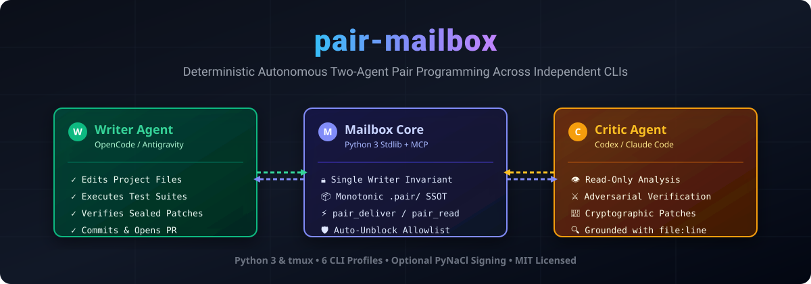

# pair-mailbox

Координация двух агентов в отдельных CLI: один пишет код, другой проверяет.
У них общий локальный MCP-ящик, список задач и журнал проверок. `pairup` запускает
tmux-сессию и супервизор. Обычные CLI работают самостоятельно.

[English](README.md) · [Установка](docs/SETUP.ru.md) · [Рабочие команды](docs/RUNBOOK.ru.md) ·
[Протокол](docs/PROTOCOL.ru.md) · [Участие](CONTRIBUTING.md) · [Безопасность](SECURITY.md)



## Требования

- Python 3.8+, Git и tmux в `PATH`.
- Для пары — два установленных CLI с настроенной авторизацией; для самостоятельной работы — один.
- Для проверочных скриптов — Bash 4.3+, рекомендуется Bash 5. Встроенный в macOS
  Bash 3.2 не запускает полный гейт. См. [установку](docs/SETUP.ru.md).
- GitHub CLI (`gh`) и доступ к репозиторию для создания или слияния GitHub PR.

Основной транспорт ящика использует стандартную библиотеку Python. Для необязательных
подписей Ed25519 и полного тестового набора нужен **PyNaCl**. Установщик не устанавливает
сами CLI, не авторизует их и не выбирает модели.

## Установить один раз

В примере движок располагается в `$HOME/pair-mailbox`. Если клон уже есть, используйте
его. Сохраняйте этот каталог: установленные MCP-записи указывают на него.

```bash
git clone https://github.com/AVP-Dev/pair-mailbox.git "$HOME/pair-mailbox"
cd "$HOME/pair-mailbox"
./install.sh --list
./install.sh codex agy
./bin/pairup --install
export PATH="$HOME/.local/bin:$PATH"
```

Замените `codex agy` установленными профилями или выполните `./install.sh` для всех
обнаруженных CLI. Строку PATH сохраните в `~/.zshrc` (zsh) или `~/.bashrc`
(интерактивный bash). Установщик обновляет MCP, инструкции, навыки и настройки
разрешений выбранных CLI. Заменяемые MCP-файлы и инструкции получают резервные копии.
Пути конфигурации и проверка подключения — в [установке](docs/SETUP.ru.md).

## Работать самостоятельно

Из целевого проекта запустите CLI обычным способом и дайте ему задачу:
Замените пример пути на настоящий каталог своего проекта.

```bash
cd "$HOME/work/my-project"
codex
# Или: agy
```

Захватывать парную роль и ждать соседа не нужно. Вне явно запущенной пары
установленный MCP успешно инициализируется и отдаёт пустой список инструментов.
Старый каталог `.pair` и унаследованные `PAIR_*` не назначают роль. После обновления
конфигурации или инструкций уже открытый CLI нужно перезапустить.

## Запустить пару

Из целевого проекта:

Если основная ветка проекта — `main`, один раз задайте её по
[инструкции](docs/SETUP.ru.md#основная-ветка-целевого-проекта). Дефолт движка — `master`.

```bash
pairup --writer codex "Изучи проект и исправь ошибку повторных запросов"
```

`--writer` необязателен: сначала используется существующая расстановка писателя,
затем доступный профиль. Критиком выбирается другой доступный CLI. Задача сохраняется
в `.pair`; Codex и agy также получают начальный интерактивный промпт.
По умолчанию агенты работают в отдельном Git worktree, а `.pair` остаётся в основном
каталоге. `pairup --in-place` выбирает текущий checkout. Повторный `pairup`
подключается к существующей сессии.

```bash
pairup                                  # Запустить или подключиться
pairup --task "Проверь повторные запросы" # То же, что задача одним аргументом
pairup --swap agy                        # Заменить критика, сохранив писателя
pairup --worktree feature/retry          # Запустить в отдельном Git worktree
```

Передавайте задачу одним аргументом в кавычках. Запись `pairup codex agy`
не выбирает два CLI и не поддерживается. Опции показывает `pairup --help`.
Для двух экземпляров одного CLI вызовите скрипт движка из целевого проекта:

```bash
PAIR_HOME="$HOME/pair-mailbox"
"$PAIR_HOME/bin/pair-duo" codex "Исправь повторные запросы"
```

Получатся роли `codex-writer` и `codex-critic`. `PAIR_HOME` здесь — обычная переменная
оболочки с путём к клону движка, а не настройка pair-mailbox.

## Профили

Актуальный источник — [cli-profiles.json](cli-profiles.json).

| Профиль | CLI | MCP-конфигурация |
|---|---|---|
| `opencode` | OpenCode | `~/.config/opencode/opencode.jsonc` |
| `agy` | Antigravity CLI | `~/.gemini/config/mcp_config.json` |
| `codex` | Codex CLI | `~/.codex/config.toml` |
| `claude` | Claude Code | `~/.claude.json` |
| `pi` | Pi Coding Agent | `~/.pi/agent/mcp.json` |
| `omp` | OMP Coding Agent | `~/.omp/agent/mcp.json` |

Профиль парного запуска Codex использует `codex --no-daemon`, чтобы MCP-процесс
принадлежал конкретному экземпляру CLI. Версия CLI должна поддерживать флаги
запуска, указанные в её профиле.

## Посмотреть состояние проекта

Глобальная ссылка устанавливается только для `pairup`. Остальные инструменты
вызывайте по пути к движку из каталога целевого проекта либо передавайте поддерживаемый
ими флаг `--state`.

```bash
PAIR_HOME="$HOME/pair-mailbox"
"$PAIR_HOME/bin/pairctl" status
"$PAIR_HOME/bin/pairctl" tasks
"$PAIR_HOME/bin/pairctl" budget
"$PAIR_HOME/bin/pairchat" --once
"$PAIR_HOME/bin/pairboard" --print-json
"$PAIR_HOME/bin/pairdoctor"
```

Права записи, автономность, подключение к tmux и восстановление описаны в
[рабочих командах](docs/RUNBOOK.ru.md). `finish.sh` — медленный вспомогательный
путь обслуживания; повседневный запуск — `pairup`.

## Принцип работы и границы

- В явно запущенной паре `pair_state` и `pair_claim` — **вызовы MCP-инструментов**,
  а не команды оболочки. Писатель правит файлы, критик проверяет и предлагает
  патчи с SHA-256. Потеря MCP не даёт критику право записи.
- Сервер проверяет операции протокола. Это не системная песочница: права CLI и
  инструкции агента тоже имеют значение. См. [модель угроз](docs/THREAT_MODEL.ru.md).
- Сообщения сохраняются в ящике. `pair_deliver` пытается разбудить соседа в tmux;
  доставка не доказывает, что сосед прочитал или выполнил задачу.
- Чтение ящика ограничено: **одно чтение за ход**; полученный `ack_token`
  подтверждает пачку при последующем чтении. См. [pair-chat](skills/pair-chat/SKILL.md).
- Супервизор отправляет напоминания, обрабатывает разрешённые промпты и перезапускает
  умершие роли в соответствии с автономностью. Завершение и слияние требуют
  зафиксированных доказательств и предусмотренных проверок.
- Нативные субагенты работают на родителя и возвращают ему результат. Движок
  координирует две верхнеуровневые роли. Автоматическая иерархия тимлидов, пулы
  работников через разные CLI и выбор моделей/бюджета пока не реализованы.

## Проверка изменений

Из клона движка, с поддерживаемым Bash в `PATH`:

```bash
cd "$HOME/pair-mailbox"
python3 -m venv .venv
. .venv/bin/activate
python -m pip install pynacl
./scripts/verify-changed.sh
./scripts/verify-project.sh --list
./scripts/verify-project.sh --jobs 1
```

[verification-profile.tsv](scripts/verification-profile.tsv) задаёт текущие проверки,
[verify-map.tsv](scripts/verify-map.tsv) выбирает затронутые наборы. Два гейта
одновременно в одном worktree запускать нельзя. Полный CI выполняется на Ubuntu 24.04
с Python 3.8–3.12. Часть тестов процессов и tmux зависит от Linux: полный набор
пока не переносим на macOS, хотя сами CLI там запускаются.

## Документация

- [Установка](docs/SETUP.ru.md): зависимости, установка, конфигурация.
- [Рабочие команды](docs/RUNBOOK.ru.md): повседневная работа и диагностика.
- [Как это работает](docs/HOW-IT-WORKS.ru.md) и [протокол](docs/PROTOCOL.ru.md).
- [Структура проекта](docs/project-structure.ru.md) и [навыки](skills/README.md).
- [Бэклог](docs/backlog/README.md): подтверждённые незакрытые задачи.
- [Записи раундов](docs/rounds/) и [архив](docs/archive/): история проекта.
- [Медиаматериалы](docs/MEDIA.ru.md): ресурсы и инструкции записи.

Готовые изменения попадают в `master`. PR — запрос на слияние рабочей ветки в основную.
Временную ветку можно удалить после слияния её работы. См. [CONTRIBUTING.md](CONTRIBUTING.md).

[Aliaksei Patskevich (AVPDev)](https://avpdev.com/) · [Лицензия MIT](LICENSE)
